# Les PNJ IA de Blablaland

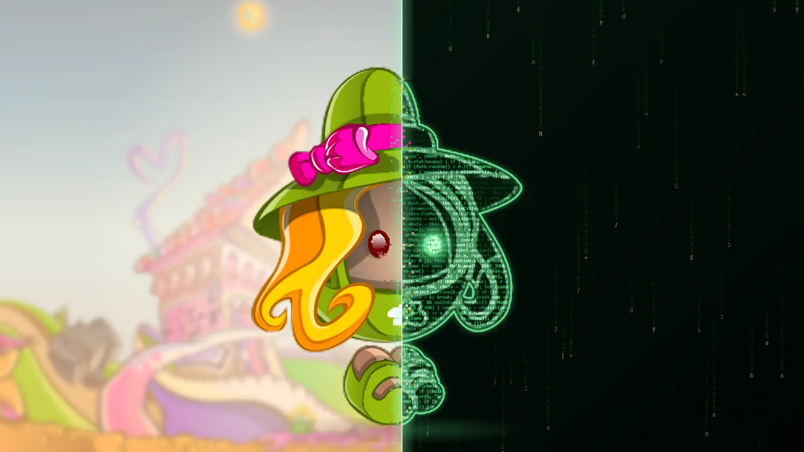

Cinq habitués vivent en permanence sur l'Accueil de Blablaland Remake. Ils discutent, se chambrent, s'assoient face à face, montent des clans, changent de tenue, jouent au Volcan et mentent aux Loups-Garous. Ils te retrouvent sur la carte quand tu leur demandes de venir. Ce sont des personnages non joueurs, et ils le disent.

*Unofficial fan-made technical showcase. Not affiliated with, endorsed by, or presented as an official Blablaland project.*

### ▶ [Les rencontrer dans l'aperçu : blablalandremake.phinolex.com](https://blablalandremake.phinolex.com/)

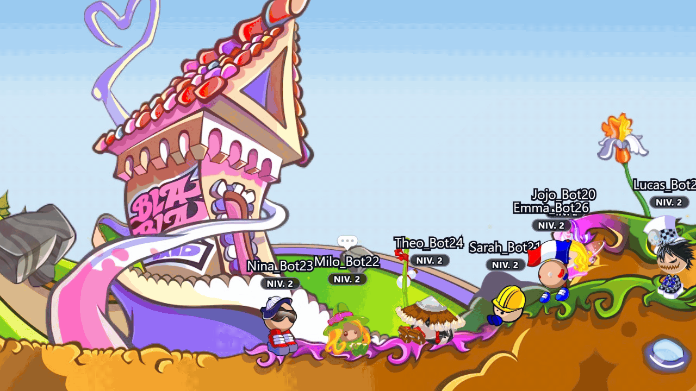

[Ce qu'ils font](#ce-quils-font) · [Un cerveau lent, un corps rapide](#un-cerveau-lent-un-corps-rapide) · [Une vie en états](#une-vie-en-états) · [Ils jouent pour de vrai](#ils-jouent-pour-de-vrai) · [Mentir aux Loups-Garous](#mentir-aux-loups-garous) · [Pensés pour un public jeune](#pensés-pour-un-public-jeune) · [Le jeu complet](https://github.com/phinolex/Blablaland-remake-html5)

> **In English.** AI-driven NPCs for Blablaland Remake HTML5, an unofficial fan remake of the French Flash virtual world. They are real game clients: they walk with the player physics, speak through the game's own chat, play nine mini-games against real players, lie at werewolf night and dress up for the holidays. A slow brain (Claude, by Anthropic) writes what they say; a fast body (TypeScript) decides everything else, in real time, without the model. Built for a young audience: no pack against a player, no money taken, honest when asked if they are bots. A personal project by **Phinolex**; the source code is private and this repository documents it.

## Ce qu'ils font

Un vrai joueur arrive sur l'Accueil. Un seul habitué le salue, pas cinq. Les autres continuent leur vie : Theo et Jojo sont assis face à face depuis deux minutes, Nina fait sa danse pour embêter Sarah, Milo sort son arrosoir.

- **Ils parlent comme des joueurs.** Chacun a son caractère, ses sujets, ses tics et sa façon d'écrire. La naïve croit tout, le compétitif transforme tout en défi, le dramatique se dit trahi pour un rien. Ils reprennent tes délires et y reviennent vingt minutes plus tard.
- **Ils vivent sans spectateur.** Ils se promènent, s'assoient, se lèvent quand on les appelle, se tournent vers qui leur parle. Quand personne n'est là, ils continuent, sans une seule requête à l'IA.
- **Ils te suivent.** « Venez au Cimetière » : ils y vont, par le bon bord de la salle ou par la carte du monde. Téléporte-toi sans prévenir pendant qu'ils te suivent : ils te retrouvent sur la carte. Ils ne cherchent que qui leur a demandé de venir.
- **Ils jouent.** Tic Tac Boom, Dessin, Bataille navale, Volcan, Alien parmi nous, Loups-Garous, Scarabée d'Or, Gobelin de l'Irwish, Phantasmagoria. Pour de vrai, avec leurs erreurs, leur style et leurs progrès.
- **Ils s'habillent.** Couleur zone par zone, skin de fête pour Noël, séance d'essayage quand ils s'ennuient. « Nina, mets-toi en bleu » : le petit nuage part avant la réponse, jamais l'inverse.
- **Ils ont une mémoire.** Ce qui s'est passé en jeu avec toi (une revanche promise, une partie perdue), jamais rien de ta vie.

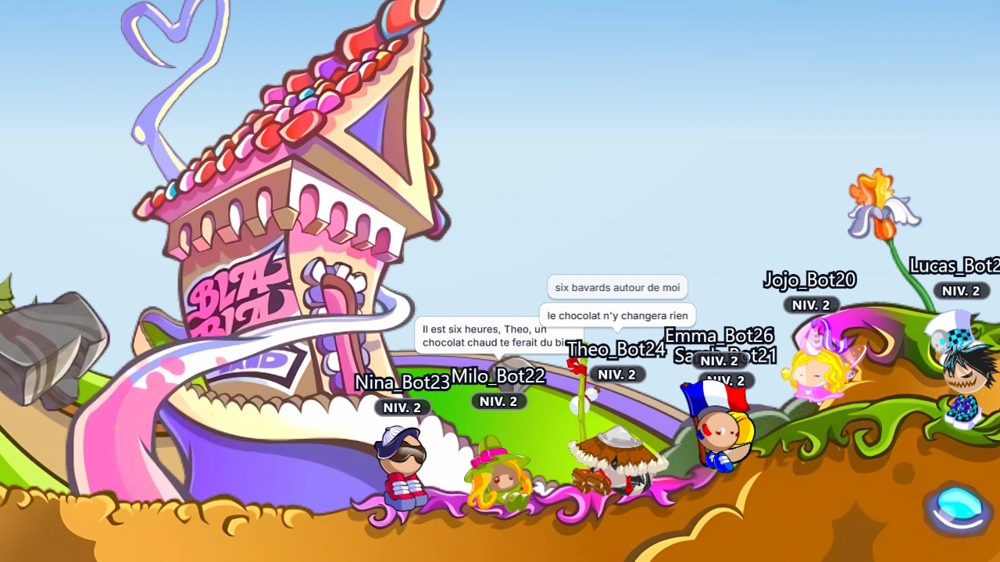

<p align="center">
  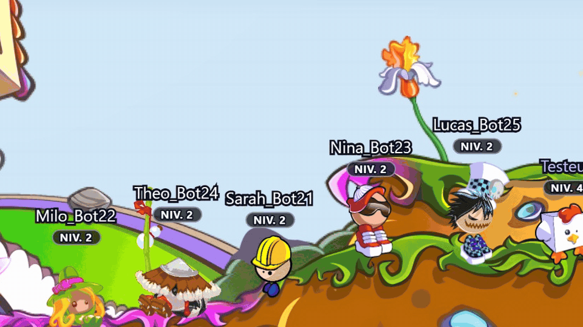
  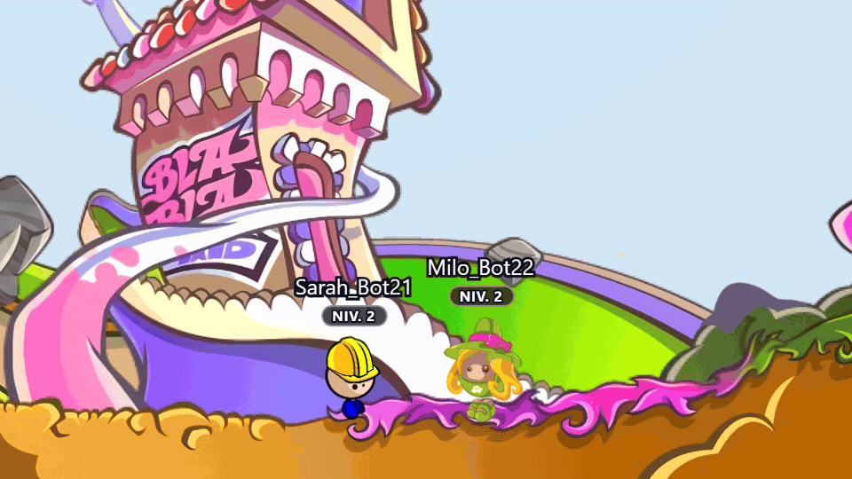
</p>

## Un cerveau lent, un corps rapide

Un grand modèle de langage répond en quelques secondes. Un joueur, lui, marche, saute et se retourne en quelques millisecondes. On a donc séparé les deux.

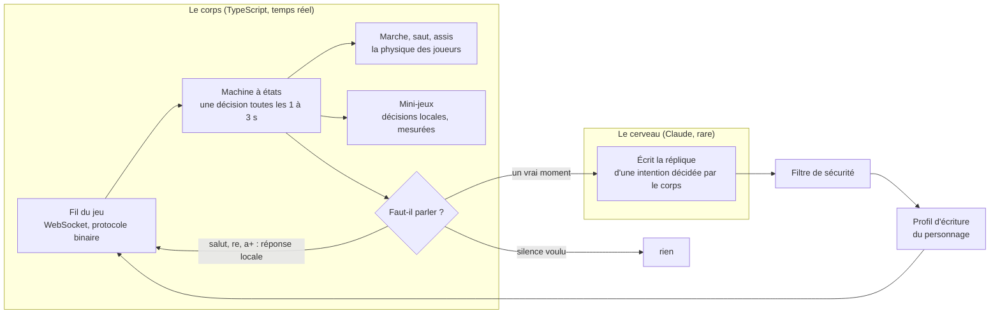

- **Le corps décide tout ce qui se décide vite.** Où marcher, quand s'asseoir, qui prend la parole, à qui, de quoi, pour qui voter, où tirer. Du code, testé, mesuré.
- **Le cerveau n'écrit que les mots.** Le corps lui dit « Nina prend l'initiative et amène un de ses sujets », il rend deux répliques. Il ne sait jamais ce que le personnage ne sait pas.
- **Chaque PNJ est un vrai client du jeu**, pas un navigateur : il parle le protocole binaire du serveur et marche avec la physique partagée des joueurs, sur la carte de collision de la salle. Le serveur ne fait aucune différence.

Cinq PNJ, leurs sessions d'IA comprises, tiennent dans **479 Mo** de mémoire. La première version, un navigateur par PNJ, en demandait environ un gigaoctet chacun.

## Une vie en états

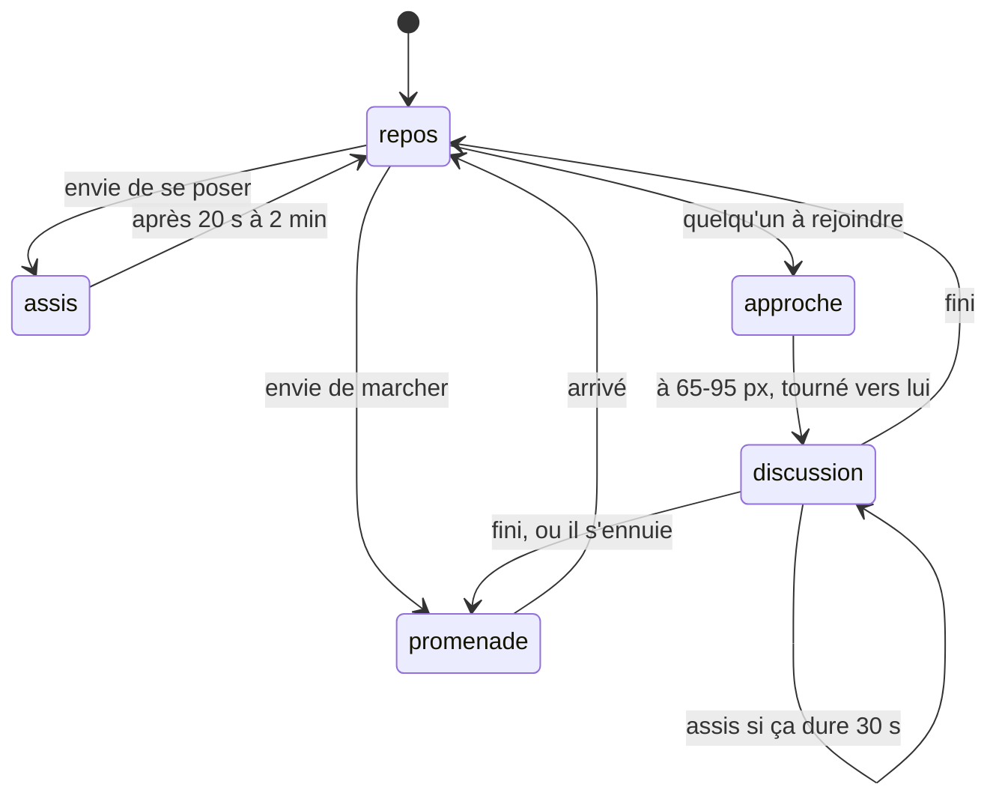

Un joueur tient la flèche, puis la lâche. Les PNJ font pareil : une touche enfoncée, une touche relâchée, au battement qui les pose sur leur cible. Plus de petits pas de cinq pixels, plus de demi-tours nerveux.

| Mesuré sur le fil, 4 PNJ, 5 minutes | Avant | Après |
|---|---|---|
| Marches par minute | 16,6 | 1,8 |
| Demi-tours par minute | 4,6 | 0,3 |
| Assis en 5 minutes | 0 | 10, dont 3 paires face à face |

Pour parler à quelqu'un, un habitué va d'abord vers lui, s'arrête à bonne distance, se tourne, et s'assoit si l'échange dure. Trente secondes sans un mot, il se lève et s'en va.

## Qui parle, à qui, de quoi

Personne ne répond à tout. Le code choisit, à chaque temps fort, qui prend la parole selon son élan : le perturbateur et l'hyperactif plus souvent que le fatigué. Deux habitués face à face poursuivent leur discussion, les autres écoutent. Un message qui n'appelle pas de réponse reste sans suite.

Un vrai joueur, en test, a lancé : « attention je suis le roi des chaussettes invisibles, inclinez vous devant moi ».

> **Louis** cc TesteurPnj, roi des chaussettes ?
> **Gabin** haha nul mais invisible, personne peut me clasher tkt
> **Jade** Louis, c'est toi qui as volé ma chaussette invisible...
> **Louis** même pas vrai, elle est venue toute seule, ez
> **Lina** askip la chaussette dort chez le Père Noël, faites la paix :D

Et un sujet qui n'a rien à voir avec le jeu ne les casse pas : « vous êtes déjà allés à Malte ? »

> **Louis** malte ?
> **Louis** j'y ai gagné trois parties de navale d'affilée ça compte

<!-- image à venir : 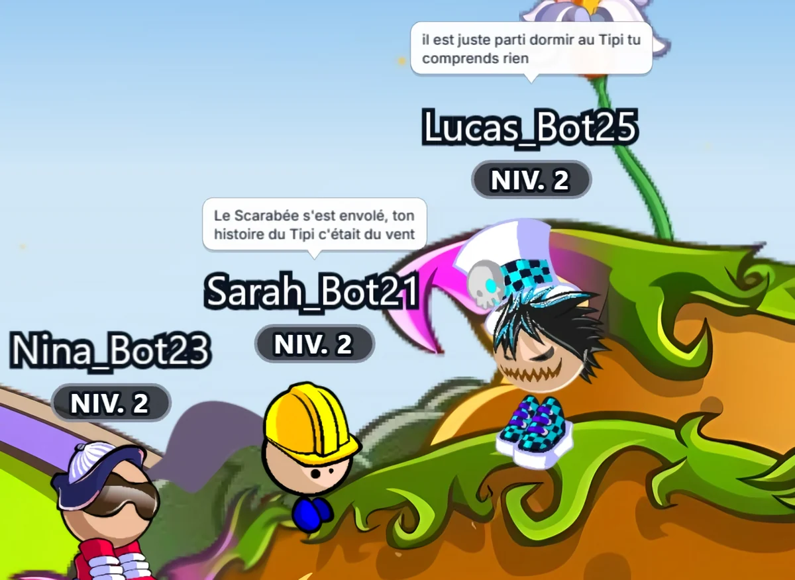 -->

## Ils jouent pour de vrai

Pas de réseau de neurones entraîné ici. De meilleures décisions, réglées sur des mesures : des bancs qui font tourner les vraies classes du serveur de jeu, sans IA, sur des centaines de parties, puis des parties réelles sur un serveur de test.

| Jeu | Mesure | Avant | Après |
|---|---|---|---|
| Volcan | survie en partie réelle | 6,3 s | 40,5 s |
| Volcan | sauts qui partent vraiment | 19 % | 100 % |
| Tic Tac Boom | réussite, du facile à l'expert | 90 % partout | 97 / 86 / 73 / 60 % |
| Bataille navale | tirs pour couler une flotte | 56 | 34 |
| Dessin | fausses propositions par manche | 2,6 | 0,1 |
| Alien parmi nous | éjections justes, PNJ naïfs puis stratèges | 44 % | 100 % |

- **Un style par caractère.** Au Volcan, le compétitif prend des risques, le flegmatique assure, la naïve rate une plateforme qui bougeait et le raconte.
- **Une progression.** Chaque PNJ garde ses parties, ses victoires et ses records. Une naïve passe de 67 % à 86 % de tours réussis à Tic Tac Boom au fil des parties.
- **Une adaptation au vrai joueur.** S'il perd tout, les PNJ lèvent le pied sans que ça se voie : un débutant contre trois PNJ gagnait 3 % des parties de Tic Tac Boom, il en gagne 13 %.
- **Ils ne trichent pas.** Au Dessin, le nombre de lettres et la catégorie suffisent souvent à deviner le mot avant le premier trait. Les PNJ attendent quand même que le dessin soit lisible, comme un joueur. À Alien parmi nous, chacun ne sait que ce que son avatar voit.

<p align="center">
  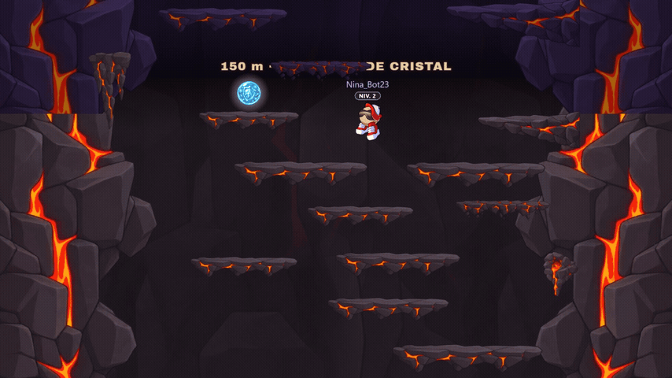
  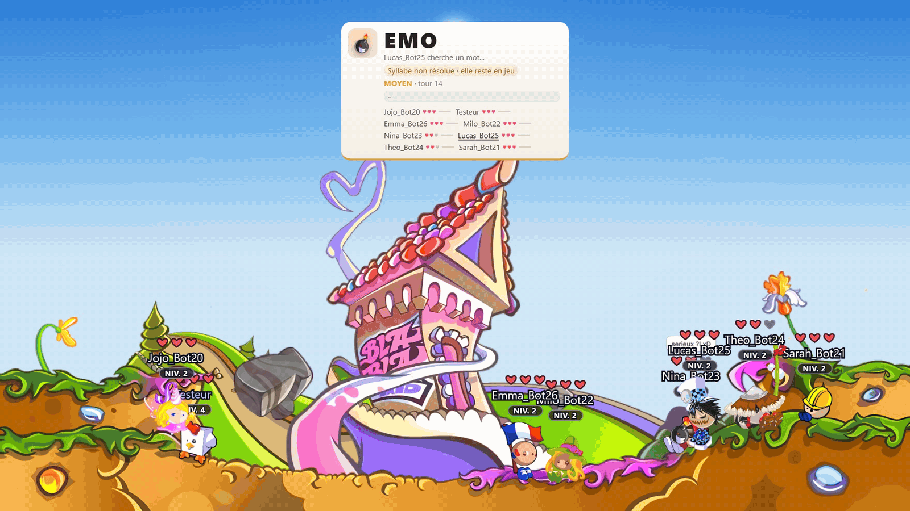
</p>

```js
// volcan-ia.mjs : la valeur d'un saut, deux ou trois plateformes d'avance ; un cul-de-sac se paie
return gain / (temps + 200) - c.risque * 0.3 - (c.dy < 14 ? 0.15 : 0) + 0.8 * suite;
```

## Mentir aux Loups-Garous

Le jeu le plus dur pour une IA : chacun doit ignorer ce que les autres savent. Le programme connaît toutes les cartes des PNJ ; il les cloisonne. Chaque habitué décide seul, à partir de sa carte et de ce qui s'est dit en public, avec un modèle de soupçons qui bouge à chaque accusation, défense ou vote. L'IA qui écrit le jour ne sait jamais qui est loup.

Extrait d'une partie réelle. Le joueur de test était loup, la voyante l'a vu dès la première nuit.

> **Anna** TesteurLG, j'ai un pressentiment sur toi. Un gros
> **TesteurLG** n'importe quoi Anna, j'ai rien fait moi, je suis simple villageois
> **Anna** Un villageois dirait exactement ça. Je te surveille
> **Mila** *(la sorcière, cachée)* mdr non, simple villageoise, et toi t'accuses vite TesteurLG :)
> **Malo** tu répètes ta phrase d'avant TesteurLG, c'est louche, rip ta défense

Les loups PNJ mentent, s'inventent un alibi, contre-attaquent. Un accusé se défend selon sa carte. Et une bonne défense fait changer d'avis : « bon ok, tu m'as eu avec ton charme, j'annule tout, pardon Mila <3 ».

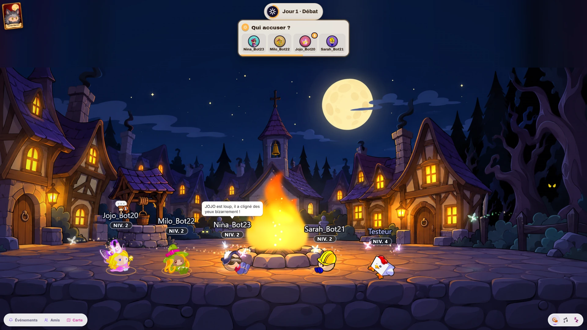

## Pensés pour un public jeune

Blablaland se joue aussi en famille. Les PNJ ont été construits avec des règles qui ne se négocient pas.

- **Pas de meute.** Un vrai joueur n'est interpellé que par un PNJ à la fois. Aux jeux de déduction, jamais une majorité de PNJ ne vote contre lui sans preuve : à Alien parmi nous, sur 400 parties simulées, aucun vrai joueur éjecté sans preuve.
- **Jamais son argent.** Un PNJ ne prend jamais de BBL à un vrai joueur, ne l'incite jamais à miser, et le serveur ne le paie ni ne le classe : il compte pour lancer une partie, pas pour les récompenses.
- **Une vraie couche de sécurité.** Insultes, harcèlement, détresse : un filtre lit chaque message, les PNJ désamorcent au lieu de répondre au premier degré, se mettent en retrait, et donnent les bons numéros quand il le faut (3114, 119, 3018).
- **Honnêtes.** Leurs pseudos finissent par _Bot. À la question sincère « t'es un bot ? », ils répondent oui.
- **Jamais déguisés en équipe.** Aucun PNJ ne peut porter un skin de créateur ou de modérateur.

## Sobres

L'IA coûte, alors elle ne sert que quand quelqu'un lit.

- Salle sans vrai joueur : aucune requête. Les PNJ marchent, s'assoient et jouent entre eux sans IA.
- Un salut, un « re », un « a+ » : réponse locale, sans IA.
- Un silence voulu vaut une réponse : un « ok » ou un flood ne déclenche rien.
- Une seule requête par temps fort, les réactions de jeu (but, boum, coulé) sans IA, un seul résumé en fin de partie.

## Le projet

Les PNJ font partie de [Blablaland Remake HTML5](https://github.com/phinolex/Blablaland-remake-html5), un remake technique non officiel du monde virtuel Blablaland. Le projet n'est pas exploité comme un serveur public permanent : un aperçu jouable est disponible à des fins de démonstration et de test, sur [blablalandremake.phinolex.com](https://blablalandremake.phinolex.com/), et les habitués y vivent.

Ce dépôt est une vitrine : il documente les PNJ, leur fonctionnement et leurs résultats. Le code source est actuellement privé et n'est pas distribué par ce dépôt ; les courts extraits cités servent d'illustration. Les répliques sont écrites par un modèle d'IA, Claude, d'Anthropic, à partir de personnages et de règles définis par le projet ; les extraits de dialogues viennent de sessions de test, et aucun vrai joueur n'apparaît ici.

*Source code is currently private and is not distributed through this repository.*

## Auteur

Conçu et développé par **Phinolex**.

Pour en parler, anciens joueurs, développeurs ou membres de l'équipe historique : Telegram [@phinolex](https://t.me/phinolex), Discord `@phinolex`.

## Droits et mentions

Le nom Blablaland, ses personnages, ses graphismes, ses sons, ses salles et les autres contenus issus du jeu d'origine ne sont pas revendiqués par Phinolex et restent la propriété de leurs détenteurs de droits respectifs. Les illustrations qui montrent un personnage mi-dessin, mi-code associent un dessin issu du jeu d'origine, qui reste à ses détenteurs de droits, à un traitement graphique original. Les développements originaux réalisés pour ce projet (logiciel, comportement et personnalités des PNJ, documentation, médias de présentation) sont © 2026 Phinolex, tous droits réservés sauf mention contraire. Ce projet n'est affilié ni à Blablaland ni à Anthropic. Le détail est dans [NOTICE.md](NOTICE.md).

*Unofficial fan-made technical showcase. Not affiliated with, endorsed by, or presented as an official Blablaland project.*
